# Unicopier system architecture

- **Status:** Canonical system-wide architecture
- **Source snapshot:** `staging-merge` at `e3159d7f`, reviewed 2026-11-25
- **Scope:** This repository and the external applications and services it calls

## 1. Purpose and authority

This document is the canonical description of how Unicopier is structured and how its main data flows work. It covers the product and marketing frontends, Supabase, the worker fleet, Edge Functions, the database, broker and source integrations, internal applications, deployment, security, operations, and recovery.

Use this document as the starting point for system questions. Use topic-specific documents for detailed procedures, incident history, and rollout plans.

The following rules apply:

1. Source code, migration history, and deployment configuration are authoritative when they disagree with older prose.
2. This document describes the checked-out source architecture. A live deployment may use another branch, database, feature flag, schedule, or secret set.
3. The **Deployment overlay** section separates those external facts from repository facts.
4. Any change that adds, removes, or moves a component, trust boundary, data flow, or deployment target must update this document in the same change.
5. Detailed runbooks remain supporting documents. They must link back here rather than create a second system map.

Related maintenance rule: the local `AGENTS.md` agent guide.

## 2. Completeness statement

### Was all of the system documented before this document?

**No.** The repository contained many useful topic documents, but the system map was fragmented. Several descriptions were stale or contradicted the code, including the parser path, Redis queue default, worker service list, broker heartbeat behavior, support desk ownership, environment names, and the existence of `apps/docs`.

### Is all of the checked-out source architecture documented now?

**Yes, at system level.** The main components, boundaries, data flows, feature defaults, and known contradictions are recorded here. This is not proof that every live environment matches this source. The open verification items in [Known gaps and contradictions](#21-known-gaps-and-contradictions) still require a live environment check.

## 3. System context

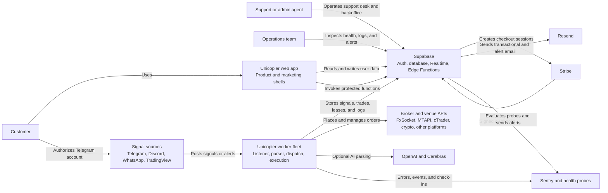

### Product responsibility

Unicopier receives trading instructions from supported sources, turns them into structured trade intent, applies the customer's broker and risk configuration, executes or manages orders, and records enough state for the web app, support desk, and operations team to understand what happened.

## 4. Repository boundaries

| Path or external repository | Responsibility | Source-of-truth status |
|---|---|---|
| `src/` | React 19 and Vite product and marketing application | Current product frontend source |
| `worker/` | Node and TypeScript listener, parser, dispatcher, trade executor, monitors, broker adapters | Current main worker source |
| `telegram-listener/` | Python and Telethon listener for sessions assigned to the Telethon engine | Alternate listener source; must use the same leases and channel contract |
| `supabase/functions/` | Deno Edge Functions | Current Edge Function source |
| `supabase/migrations/` | PostgreSQL schema, RLS, RPCs, triggers, retention, and cron history | Database change history; apply to a target before relying on a new object |
| `supabase/config.toml` | Supabase function gateway JWT routing | Repository routing intent; verify the live project |
| `apps/backoffice/` | Separate in-repository internal admin UI | Current in-repository backoffice source |
| `apps/support-admin/` | Historical copy of the support desk | **Not live source. Do not edit or deploy.** |
| `apps/mobile/` | Expo and iOS artifacts without an application entry point | Not a runnable application in this checkout |
| `apps/docs/` | Referenced by root scripts and CI but absent | Missing component, not an active application |
| `.opencode/plugins/support-admin/` | Local OpenCode read-only support chat and image reader | Local agent extension; not part of the deployed product |
| `.opencode/skills/support-admin/` | Local skill instructions for the support reader | Local agent guidance; not runtime code |
| `tartarixinc/support-admin` | Live support desk at `unicopier.support` | External source of truth for the support UI |
| `tartarixinc/tscopier-admin` | Separate deep operations dashboard | External source of truth for that dashboard |
| `docs/` | Architecture, runbooks, incidents, memory, and project records | Supporting documentation; this file is canonical for architecture |

Primary code references: [frontend entry](../src/main.tsx), [worker configuration](../worker/src/workerConfig.ts), [Edge routing](../supabase/config.toml), [Netlify configuration](../netlify.toml).

## 5. Deployment topology

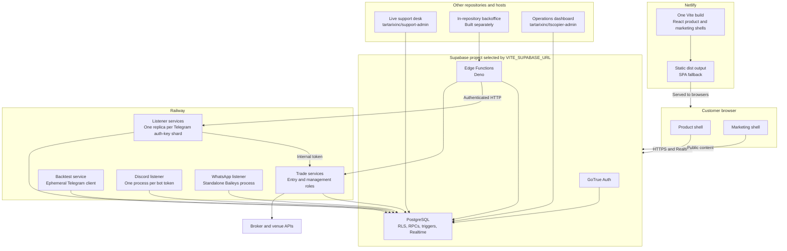

### 5.1 Frontend shells

The root build contains two mutually exclusive React applications:

- The **product shell** in [src/App.tsx](../src/App.tsx) provides authentication, dashboard, broker and source setup, trades, signal history, settings, billing, support, social copy, and backtesting.
- The **marketing shell** in [src/MarketingApp.tsx](../src/MarketingApp.tsx) provides the public site, pricing, provider profiles, legal pages, and referral entry points.

[src/main.tsx](../src/main.tsx) selects the shell before the main application loads. [src/lib/site.ts](../src/lib/site.ts) applies this order:

1. `?site=app` or `?site=marketing` overrides everything.
2. `VITE_DEV_SITE=app` or `VITE_DEV_SITE=marketing` is the build-time fallback.
3. Known product hosts mount the product shell.
4. Known marketing hosts and other Netlify hosts mount the marketing shell.
5. Localhost and unknown `app.*` hosts default to the product shell.
6. Other unknown hosts default to marketing.

The shell choice does not choose a backend. The backend is selected by the build-time `VITE_SUPABASE_URL`.

### 5.2 Product provider and access layers

The product shell uses these layers in order:

```text
Theme and application bootstrap
└── AuthProvider
    └── LocaleProvider
        └── ConfirmDialogProvider
            └── UserProfileProvider
                └── BrowserRouter
                    └── Application banners
                        └── SubscriptionProvider
                            └── Email verification gate
                                └── Protected route
                                    └── Subscription guard
                                        └── App shell and feature providers
```

The access rules are:

- Supabase Auth establishes the user session.
- Email verification gates protected product routes.
- The subscription guard loads entitlement and usage state but does not remove an inactive user from every route. Individual actions apply plan limits and feature checks.
- Admins receive Advanced-plan treatment.
- A live admin-granted subscription extension can also provide access.
- Browser feature flags can hide social trading or lock Discord in source pickers. Both default to enabled unless the build value is exactly `false`.

The browser does not contain a service-role key. Privileged writes happen in Edge Functions or in worker and service-role paths.

### 5.3 Netlify behavior

[netlify.toml](../netlify.toml) defines:

- build command: `npm run build`;
- publish directory: `dist`;
- one-year immutable caching for hashed assets;
- revalidation for the application shell;
- `/*` to `/index.html` with status 200 for client-side routing.

Netlify aliases, domain routing, branch selection, and `VITE_*` values are external settings. They are listed in the [Deployment overlay](#19-deployment-overlay).

## 6. Supabase platform

Supabase provides the shared control plane for the product:

- **Auth:** user sessions, email confirmation, password and OAuth flows, Turnstile enforcement, and account recovery.
- **PostgreSQL:** system of record for users, subscriptions, source connections, signals, trades, execution logs, leases, support, and operations state.
- **Realtime:** live updates to the browser and wake-ups for workers.
- **Edge Functions:** request-facing APIs for account features, billing, support, broker connections, scheduled jobs, and administration.
- **Cron:** invokes scheduled Edge Functions and SQL maintenance where configured.

The browser client in [src/lib/supabase.ts](../src/lib/supabase.ts) uses the anonymous key, persists sessions, refreshes tokens, detects URL session callbacks, and can use a separate `VITE_SUPABASE_REALTIME_URL` endpoint.

## 7. Worker fleet

### 7.1 Supported roles

[worker/src/workerConfig.ts](../worker/src/workerConfig.ts) defines the roles below. The table describes supported source roles, not the number of live Railway services.

| Role | Main work |
|---|---|
| `all` | Listener, channel listener, trade execution, management, and backtest HTTP in one process |
| `listener` | Telegram MTProto ingestion and user listener work |
| `channel_listener` | Channel-scoped ingestion coordinated by channel reader leases |
| `trade` | Trade execution and management plus all trade monitors |
| `trade_entry` | Entry execution and execution-side monitors |
| `trade_mgmt` | Management actions and management-side reconciliation monitors |
| `backtest` | Ephemeral Telegram client and backtest synchronization |
| `discord_listener` | Discord gateway ingestion only |

The worker also has separate entry points for WhatsApp and the Discord library process. The source supports splitting entry and management work, but the live Railway topology must be checked before assuming a particular fleet.

### 7.2 Sharding and singleton rules

- `WORKER_SHARD_ID` and `WORKER_SHARD_COUNT` determine which users a worker owns.
- Listener, entry, management, and queue shard counts must agree.
- A Telegram auth key may have only one active MTProto connection. A listener shard must have one replica.
- The Discord gateway must have one process per bot token.
- A queue shard must have a matching deployed trade shard.
- A trade worker without the correct shard cannot accept a user signal, even if a request reaches it.

### 7.3 Main worker subsystems

| Area | Main source | Responsibility |
|---|---|---|
| Session and listener management | `worker/src/sessionManager.ts`, `worker/src/userListener.ts` | Telegram sessions, leases, reconnection, source polling |
| Canonical channel ingestion | `worker/src/channelCanonicalIngest.ts`, `worker/src/channelSignalProjector.ts` | One parsed channel signal projected to subscribers |
| Parsing | `worker/src/parseSignal.ts`, `worker/src/signalIntent/` | Deterministic parsing, AI intent, reconciliation, grounding |
| Dispatch | `worker/src/tradeSignalPush.ts`, `worker/src/queue/` | HTTP push, Redis Streams, Realtime, sweep, idempotency |
| Trade execution | `worker/src/tradeExecutor/` | Claims, planning, entries, management, broker calls, records |
| Broker adapters | `worker/src/*Provider.ts`, `worker/src/providerResolver.ts` | Provider-neutral order and account operations |
| Credentials and write safety | `worker/src/aesGcmEnvelope.ts`, `worker/src/brokerCredentialsCrypto.ts`, `worker/src/brokerWriteAuthority.ts` | Encryption, key rotation, writer epochs, write leases |
| Reconciliation | `worker/src/*Reconcile*`, `worker/src/*Monitor.ts` | Database and broker state convergence |
| Observability | `worker/src/observability/` | Sentry, business events, execution logs, health probes |

## 8. Core component diagram

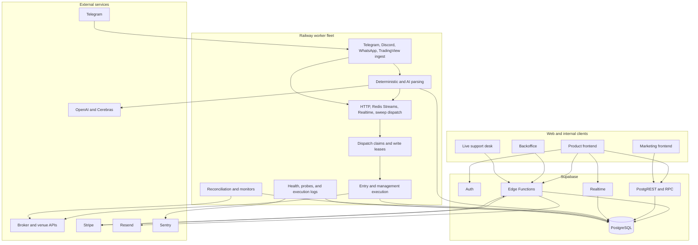

## 9. Signal parsing and intent model

### 9.1 Parse stages

The current worker does not use a fixed “regex, then Cerebras, then GPT-4o” chain for every message. It has a deterministic stage, optional AI stages, and four modes.

1. **Deterministic stage:** channel keywords, aliases, lexicon, price and unit rules, management phrases, and provider-specific patterns produce a candidate.
2. **Stage 2 AI:** when needed, Cerebras OSS parses the message into `TradeIntent`; OpenAI is the fallback if Cerebras is unavailable.
3. **Modification grounding:** modification results are checked against open trades and, for a reply, the parent signal's symbol.
4. **Stage 3 reconciliation:** GPT-4o can arbitrate disagreement, uncertainty, invalid values, or a missing target. It runs only when reconciliation is enabled and the trigger conditions are met.
5. **Final routing:** the selected mode decides whether the deterministic or AI result is executable.

### 9.2 Parse modes

| `UNIVERSAL_PARSE_MODE` | Result behavior |
|---|---|
| `off` | Deterministic parsing only |
| `shadow` | Deterministic result is authoritative; AI runs for comparison and differences are logged |
| `fastpath` | Qualified deterministic messages use the fast lane; other messages use AI and conditional reconciliation |
| `primary` | AI is preferred for non-fast-lane messages, with deterministic fallback when AI is unavailable |

The repository default is `shadow`. This means adding AI keys alone does not make AI the executable parser.

### 9.3 Trade intent

The normalized intent can represent an entry, modification, close, breakeven, partial close, pending cancel, commentary, ignore, or uncertain result. It records side, symbol, entry prices or zones, stop loss, take-profit levels, units, and flags such as market-now, re-entry, open take profit, and partial-close fraction.

Management parsing is grounded so a stop or target change cannot silently target an unrelated or already closed position.

## 10. End-to-end data flows

### 10.1 Telegram entry signal

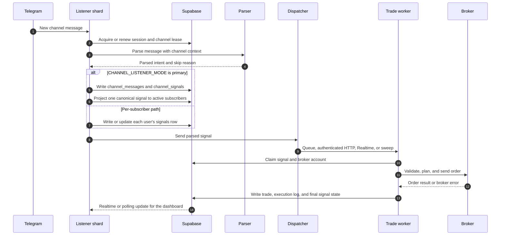

Important details:

- The listener persists the source signal before dispatch so execution records have a valid `signals` foreign key.
- A duplicate source message creates a non-executable stub and does not dispatch again.
- The dispatcher chooses the target from the action and user shard. Entry and management actions can use different worker URLs.
- The trade worker fails closed if it cannot prove ownership of a dispatch claim or broker write authority.
- Broker failure is recorded and classified. It does not make an uncertain claim look successful.

### 10.2 Management update

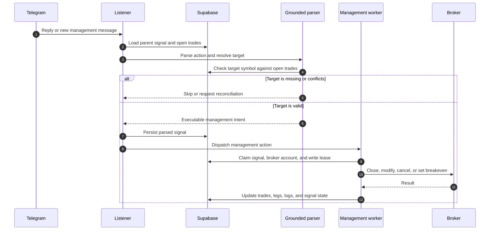

Management work includes full or partial close, stop and target changes, breakeven, trailing stop, pending-order cancellation, basket reconciliation, and broker-side close handling.

### 10.3 Other signal sources

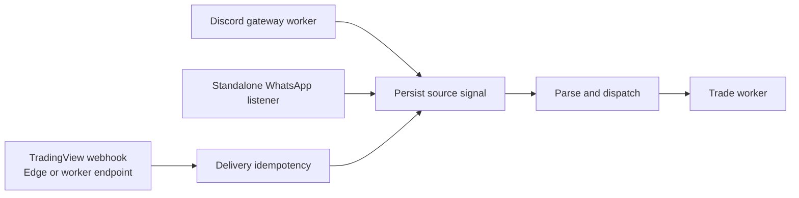

Source-specific behavior:

- Discord uses one gateway process per bot token and records installation, guild, and channel state.
- WhatsApp reads linked groups only, stores Baileys credentials in encrypted form, writes `source_kind=whatsapp`, and never sends messages or manages groups.
- TradingView requests use a path token and may use an IP allowlist. The worker records a delivery idempotency key and rejects a repeated delivery only when the alert expands to the same stable alert ID. An identical static body without an expanded ID intentionally receives a new key and is accepted on every provider fire.

### 10.4 Broker connection and provider transition

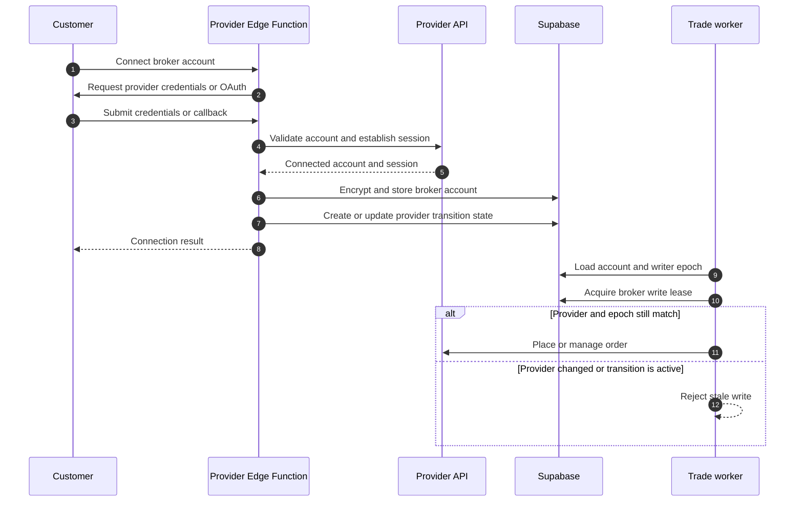

Provider names in the source are `fxsocket`, `mtapi`, `ctrader`, `binance`, `bybit`, `kucoin`, `dxtrade`, `tradelocker`, and `matchtrader`. Availability depends on the environment, account, credentials, and migration state.

### 10.5 Subscription and entitlement

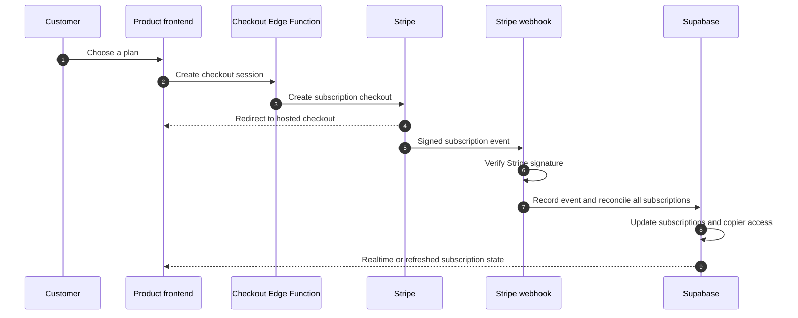

The browser can also ask the `confirm-checkout` function to reconcile a checkout that completed before the webhook arrived. Subscription changes pause or restore copier execution and remove listener leases when access is revoked. Expired FxSocket accounts are disconnected by a separate scheduled job after the subscription grace period; restoring a subscription does not recreate a broker session.

### 10.6 Support

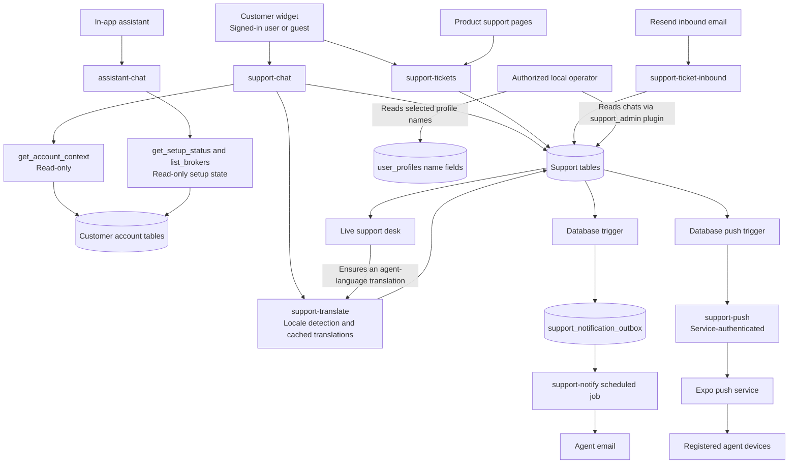

The email path is durable. A ticket or chat event is written to an outbox by a database trigger. The scheduled sender retries with backoff and records delivery failures. The `support_notify_backlog` alert rule detects a stuck outbox.

Support-chat language is separate from the product interface language. German (`de`) and Turkish (`tr`) are valid support locales and complete product-interface locales: the product ships full German and Turkish UI bundles (`src/i18n`), so a German or Turkish browser gets German or Turkish chat and interface text. The widget sends the stored customer choice first, then the browser language, then the active product language; the chat language follows the same choice, and an explicit stored English choice remains English. The support desk source's desktop and mobile chat-language pickers include `de` as **Deutsch**, allowing agents to request German translations. `support-chat` checks every textual message when the preferred locale is not English, and checks likely non-English text when the preferred locale is English, before storing the detected `source_locale`. The cheap English-preference check recognizes non-Latin scripts and Turkish; it does not heuristically identify German because German and English share many words. `support-translate` keeps the original body immutable while caching translations by target locale. The `support-translate` `repair_source_locale` action is the controlled path for older rows that were saved as English before their locale was supported: it requires a support-agent or administrator JWT, accepts at most 100 message IDs, re-detects each original, clears stale translations when the source locale changes, and writes only `source_locale` and `translations`.

A target that does not yet have the support translation and locale columns must apply `20261116090000_support_message_translations.sql` first. Apply the Turkish locale migration (`20261126150000_support_turkish_locale.sql`) before the German locale migration (`20261126160000_support_german_locale.sql`). The German migration recreates the conversation, ticket, chat-message, and ticket-message locale checks with both `tr` and `de`, and fails fast if the Turkish migration has not established all four constraints. Functions that can store German or Turkish support messages and the updated product frontend must not be deployed before the required migrations are applied, and the final live checks must contain both locale codes.

The mobile-push path is separate and best effort. Database triggers call the service-authenticated `support-push` function, which filters registered agent devices by notification preferences and sends through Expo. A push failure does not block the support write and is not a replacement for the durable email outbox. Whether agents have registered devices and whether the live deployment enables push are external state.

A signed-in customer can ask the support AI for live plan and setup facts. The AI calls the read-only `get_account_context` tool. The function derives the user ID from the authenticated request, scopes every account query to that ID, and returns only the subscription state, calculated limits, channel summary, broker-account summary, and usage counts. It does not accept a user ID from the model and does not expose internal IDs, broker login IDs, server names, credentials, provider-session identifiers, Stripe IDs, raw signals, or write operations. If a required database read fails, the tool returns an explicit verification error instead of an empty or inactive account state. Guests receive static plan facts and are asked to sign in for account-specific state.

The in-app assistant follows the same account-state boundary through its existing `get_setup_status` and `list_brokers` tools. Those tools read only the authenticated user's setup. When the assistant must select a broker for a later action, the model receives an opaque, user-scoped `broker_handle`; the function resolves that handle server-side within the same user scope. Database broker IDs, broker login IDs, server names, and provider-session values are not returned in the model-visible broker summaries.

The browser and Edge Functions use the same broker connection-state resolver in `supabase/functions/_shared/brokerConnectionStatus.ts`. Error and recovering states take precedence, a known-good terminal or connected provider state is accepted, and a provider error is not hidden by a stale generic state. The browser facade in `src/lib/brokerReconnect.ts` delegates to this resolver, and the Social Trading account label also uses that facade. The shared resolver keeps Account Configuration, Social Trading eligibility, and assistant answers consistent.

For assistant reporting, the Telegram-channel figure counts active Telegram sources only. TradingView, Discord, WhatsApp, and paused Telegram rows remain visible but do not inflate that assistant figure. This is a reporting comparison, not a whole-account entitlement verdict: the product's entitlement enforcement also considers active non-Telegram sources. `brokers_connected` means active and connected for compatibility, while `brokers_connected_total` also includes connected accounts that are paused. The existing entitlement checker and frontend usage counter are unchanged and continue to count active non-TradingView source rows.

Plan prices and rendered limit facts have one canonical source in the main repository: `supabase/functions/_shared/planFacts.ts` uses the shared entitlement core in `supabase/functions/_shared/planLimits.ts`, and the product pricing and frontend plan-limit modules build on those files. The external support-desk repository cannot import runtime code from this repository, so it keeps the versioned static snapshot `plan-facts-v2026-11-25`. These shared facts do not change prices, subscriptions, or entitlement enforcement.

The live desk is also documented as providing a Customers view that links a customer to their support records. That view lives in the external `tartarixinc/support-admin` repository and was not independently inspected in this source-only audit.

The support desk deep links are an external contract:

- `/tickets?ticket=<uuid>` opens one ticket.
- `/?chat=<uuid>` opens one conversation.

Alert email must continue to use those exact query parameters.

A project-local OpenCode plugin can read the same support chats for an authorized operator. The `support_admin` tool at [`.opencode/plugins/support-admin/index.ts`](../.opencode/plugins/support-admin/index.ts) supports listing conversations, reading one thread, and fetching one image as an inline attachment. It is deliberately read-only: it exposes fixed `support_conversations` and `support_messages` reads plus a selected `user_profiles` identity read (`user_id`, `display_name`, `username`, `first_name`, and `last_name`) for signed-in customers, assigned agents, and message senders. The returned profile shape is exactly those five fields plus the derived `name`, which prefers the display name, then the combined first and last name, then the username. It requires UUID or bounded filters, never returns `guest_token` or profile email/address fields, and validates image URLs as HTTPS objects in the `support-attachments` bucket from an allowed storage origin before fetching them. Conversation search covers guest details, subject, and signed-in customer display names, usernames, first names, and last names. Search text is matched literally, and searches broad enough to exceed the bounded profile-ID limit fail explicitly instead of returning an incomplete result. It obtains a service-role key from dedicated environment variables or the locally authenticated Supabase CLI; the key is never written to the repository or returned by the tool. The companion skill at [`.opencode/skills/support-admin/SKILL.md`](../.opencode/skills/support-admin/SKILL.md) documents the read-only workflow. This is a local operator tool, not a deployed product endpoint, and it cannot claim, reply, resolve, close, edit, or reassign a chat.

### 10.7 Social copy and mirror copy

Social copy and mirror copy bypass the Telegram signal pipeline. They observe positions in an existing broker account and reproduce them to another broker account.

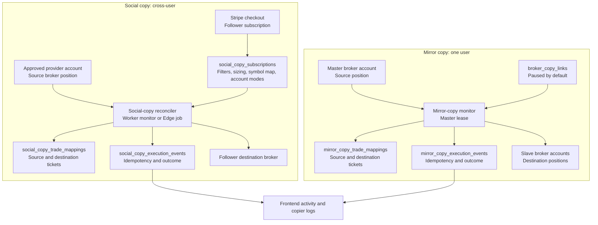

The two paths share broker-session resolution, write-authority checks, position normalization, sizing, and volume-clamping helpers. They keep separate symbol-mapping implementations, execution-event tables, claiming logic, mappings, and audit records.

Social copy uses a paid subscription between a follower and an approved provider. The reconciler can run in a worker monitor or in the `social-copy-reconcile` Edge Function; database leases and `skip locked` prevent both from owning the same subscription at once. It applies the subscription's account-mode, filters, sizing, symbol map, stop, and target rules.

Mirror copy links one user's master account to that user's slave accounts. The monitor claims a master account under a short lease and requires a confirmed hedging mode on each destination so a second position cannot merge with an existing position.

Both paths fail closed on uncertain broker outcomes. One copy per source ticket is enforced by mapping uniqueness and execution-event idempotency; an uncertain open is not retried as if it were definitely absent.

### 10.8 Backtesting

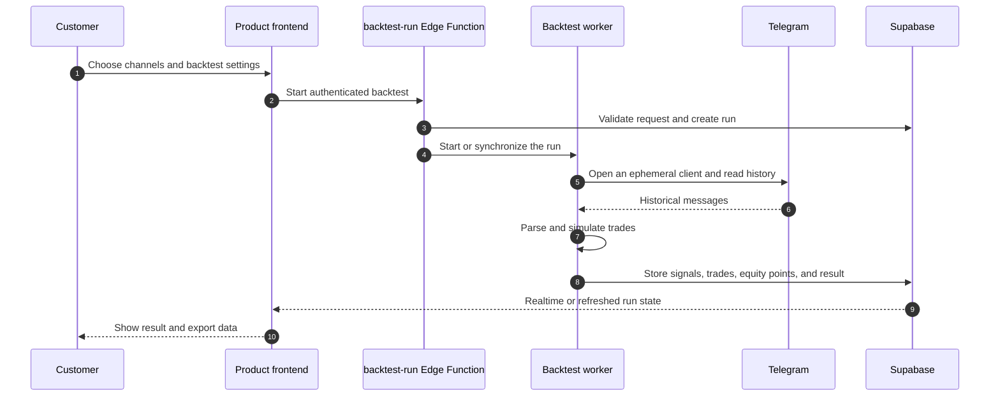

A backtest client is short-lived and must not take over a live listener's Telegram session. Market data and simulation rules are separated from live order execution.

## 11. Dispatch, claiming, and duplicate protection

### 11.1 Dispatch options

| Mechanism | Purpose | Default and constraints |
|---|---|---|
| Authenticated worker HTTP | Low-latency listener-to-trade handoff | Enabled by default when a target URL and internal token exist |
| Redis Streams | Durable entry and management lanes | Disabled unless `TRADE_SIGNAL_QUEUE_ENABLED=true`; may be limited to canary shards |
| Supabase Realtime | Wake a trade worker when a parsed signal appears | Enabled by default for `all` and `trade`; disabled by default for split entry and management roles |
| Parsed-row sweep | Recover work missed by a push or wake-up | Runs in the trade executor with a bounded replay window |

The dispatcher retries transient HTTP failures and opens a circuit breaker for persistent route or authentication failures. A failed queue push can fall back to direct delivery when configured.

### 11.2 Protection layers

Duplicate execution is prevented by several independent controls:

1. **Source uniqueness:** one message is tied to a channel and user through database uniqueness.
2. **`ensureSignalRow`:** guarantees the signal foreign-key row exists and converts a duplicate message into a non-executable stub.
3. **Queue idempotency:** the idempotency key includes signal, user, action class, broker account, and message revision.
4. **Dispatch claim:** `signal_broker_dispatch_claims` grants one worker a renewable lease for a signal and broker account.
5. **Process state:** in-flight and queued sets prevent overlapping work in one worker process.
6. **Provider write fence:** a writer epoch and write lease reject a write from a stale provider or during a provider transition.
7. **Broker reconciliation:** open orders and positions are compared with database records to recover or fence uncertain outcomes.

No single layer is sufficient by itself. Changes to dispatch or execution must preserve all applicable layers.

## 12. Database architecture

### 12.1 Scale and ownership

The reviewed `a4a2dcc4` snapshot contains 309 SQL migration files. A static inventory of that committed snapshot found:

- 110 unique created tables;
- 3 views;
- 205 unique created function names;
- 108 table-level RLS enablement statements;
- 218 policy creation statements;
- 19 historical cron declarations for 15 unique job names.

These counts describe repository history, not the exact contents of a live database. A later migration can drop or replace an object.

### 12.2 Main data domains

| Domain | Main records | Purpose |
|---|---|---|
| Identity and entitlement | `user_profiles`, `subscriptions`, `subscription_extensions`, `subscription_recovery_codes`, `auth_abuse_rate_limits`, `email_verification_sends` | Account state, access, abuse controls, and verification |
| Wallet, referrals, and affiliates | `user_wallets`, `wallet_ledger`, `referral_attributions`, `affiliate_profiles`, `commission_ledger`, `payout_batches`, `platform_fee_settings` | Balances, attribution, commission, and payouts |
| Broker connections | `broker_accounts`, `fxsocket_broker_accounts`, `broker_channel_trading_configs`, `broker_connection_events`, `broker_write_leases`, `mt_servers`, `mt_server_connect_locks`, `matchtrader_order_tags` | Account identity, provider session, risk configuration, transitions, and write safety |
| Source connections | `telegram_sessions`, `telegram_channels`, `telegram_account_claims`, `telegram_auth_pending`, `discord_installations`, `discord_guild_channels`, `discord_channels`, `whatsapp_sessions`, `whatsapp_auth`, `whatsapp_groups`, `tradingview_webhooks`, `tradingview_webhook_deliveries` | User source accounts and subscriptions |
| Canonical channels | `signal_channels`, `channel_messages`, `channel_signals`, `channel_listener_leases`, `channel_signal_examples`, `channel_signal_lexicon`, `channel_signal_profiles`, `channel_trading_presets`, `channel_active_trade_params`, `channel_trade_signals` | Shared source identity, parsing context, reader election, and channel configuration |
| Signals and execution | `signals`, `signal_broker_dispatch_claims`, `signal_queue_idempotency`, `signal_queue_dead_letters`, `signal_entry_pending_orders`, `signal_range_entry_waits`, `trade_execution_logs`, `trades`, `trade_channel_attributions`, `trade_reports` | Parsed instruction, dispatch, execution, order state, and audit |
| Position management | `partial_tp_legs`, `range_pending_legs`, `range_pending_tp_locks`, `basket_sl_tp_targets`, `basket_reconcile_jobs`, `basket_reconcile_legs`, `layering_plans`, `management_jobs` | Partial targets, pending ranges, baskets, and management state |
| Backtesting | `backtest_runs`, `backtest_run_channels`, `backtest_channel_signals`, `backtest_trades`, `backtest_equity_points` | Historical simulation inputs and results |
| Social and mirror copy | `social_profiles`, `social_follow_relationships`, `provider_applications`, `social_copy_sources`, `social_copy_subscriptions`, `social_copy_billing`, `social_copy_runtime_config`, `social_copy_trade_mappings`, `social_copy_execution_events`, `social_trader_reviews`, `broker_copy_links`, `mirror_copy_master_state`, `mirror_copy_link_state`, `mirror_copy_trade_mappings`, `mirror_copy_execution_events` | Providers, followers, paid copy, mirrors, and their execution records |
| Support | `support_conversations`, `support_messages`, `support_tickets`, `support_ticket_messages`, `support_notification_outbox`, `support_notification_recipients`, `support_agent_conversation_reads`, `support_agent_notification_prefs`, `support_agent_push_tokens`, `support_conversation_feedback`, `support_desk_comments`, `support_message_flags` | Chat, tickets, agent state, feedback, and notifications |
| Operations and alerts | `alert_rules`, `alert_events`, `alert_recipients`, `system_probe_state`, `system_probe_samples`, `system_probe_events`, `copier_listener_health`, `worker_session_leases`, `listener_events`, `admin_audit_logs` | Health, leases, audit, alerts, and diagnosis |
| Application content | `app_settings`, `in_app_notifications`, `assistant_threads`, `landing_announcements`, `marketing_promo_banner` | Product settings, notifications, assistant history, and public content |

### 12.3 Row-level security model

- Browser data access uses the anonymous or user key and is constrained by RLS.
- User-owned records normally use `auth.uid() = user_id` or an equivalent policy.
- Subscription, privileged profile, administrative, and support fields have narrower policies.
- Support-agent access is database-controlled through the support and admin helper functions.
- Service-role clients bypass RLS. Worker and Edge Function code must therefore validate the caller, role, token, resource ownership, and transition state itself.
- A new browser-visible table must have explicit RLS policies before it is exposed. The number of created tables and the number of RLS enablement statements are not equal.

### 12.4 Scheduled database and Edge jobs

The repository has historical declarations for these jobs:

- `alert-evaluator`
- `basket-sl-tp-sweep`
- `broker-session-keepalive`
- `disconnect-expired-fxsocket-brokers`
- `expire-timed-admin-access`
- `prune-listener-events`
- `prune-monitoring-tables`
- `prune-support-notifications`
- `purge-stale-trade-prices`
- `range-pending-sweep`
- `reconcile-expired-trials`
- `refresh-social-source-snapshots`
- `signal-reconcile-sweep`
- `social-copy-reconcile`
- `support-notify`

A later migration may replace a schedule. Check `cron.job` in the target database for the live truth.

## 13. Edge Functions

### 13.1 Inventory

The repository contains 70 Edge Functions.

| Family | Functions |
|---|---|
| Authentication, account, and user features | `auth-before-user-created`, `send-verification-email`, `send-password-reset-email`, `email-unsubscribe`, `redeem-recovery-code`, `apply-referral-code`, `telegram-auth`, `upsert-telegram-channel`, `customer-portal`, `billing-history`, `update-extra-accounts`, `configure-with-ai`, `assistant-chat`, `systems-health-assistant` |
| Broker and provider operations | `provider-connect`, `provider-transition`, `fxsocket-broker`, `mtapi-broker`, `ctrader-broker`, `binance-broker`, `bybit-broker`, `kucoin-broker`, `dxtrade-broker`, `tradelocker-broker`, `matchtrader-broker`, `mtapi-clock-probe`, `disconnect-expired-fxsocket-brokers` |
| Signal and trade administration | `parse-signal`, `execute-trade`, `analyze-channel-profile`, `signal-override`, `clear-channel-active-params`, `force-close-trades`, `retry-signal`, `retry-activity`, `backtest-run`, `discord-sync`, `tradingview-webhook`, `layering-mode-capabilities`, `update-layering-settings`, `signal-review-email`, `manual-broker-override-email` |
| Billing, affiliates, and social copy | `create-checkout-session`, `confirm-checkout`, `stripe-webhook`, `reconcile-stripe-entitlement`, `reconcile-expired-trials`, `billing-backfill`, `send-subscription-email`, `send-subscription-campaigns`, `send-provider-approval-email`, `affiliate-connect`, `affiliate-profile`, `create-social-copy-checkout`, `social-copy-portal`, `social-copy-reconcile` |
| Support, status, and information | `support-chat`, `support-tickets`, `support-ticket-inbound`, `support-translate`, `support-push`, `support-notify`, `public-status`, `alert-evaluator`, `systems-health-railway`, `market-news`, `economic-calendar`, `signal-reconcile-sweep` |
| Administration | `admin-query`, `admin-mutate` |

The inventory does not prove that every function is deployed or active in every environment.

### 13.2 Gateway JWT configuration

[supabase/config.toml](../supabase/config.toml) contains 50 explicit entries:

- **26 with `verify_jwt=true`:** `assistant-chat`, `binance-broker`, `bybit-broker`, `configure-with-ai`, `confirm-checkout`, `create-checkout-session`, `create-social-copy-checkout`, `ctrader-broker`, `customer-portal`, `discord-sync`, `dxtrade-broker`, `economic-calendar`, `fxsocket-broker`, `kucoin-broker`, `layering-mode-capabilities`, `manual-broker-override-email`, `market-news`, `matchtrader-broker`, `provider-connect`, `signal-review-email`, `social-copy-portal`, `systems-health-assistant`, `tradelocker-broker`, `update-extra-accounts`, `update-layering-settings`, `upsert-telegram-channel`.
- **24 with `verify_jwt=false`:** `alert-evaluator`, `auth-before-user-created`, `backtest-run`, `billing-backfill`, `clear-channel-active-params`, `email-unsubscribe`, `execute-trade`, `parse-signal`, `provider-transition`, `public-status`, `reconcile-expired-trials`, `reconcile-stripe-entitlement`, `send-password-reset-email`, `send-subscription-campaigns`, `send-subscription-email`, `send-verification-email`, `signal-reconcile-sweep`, `stripe-webhook`, `support-chat`, `support-push`, `support-ticket-inbound`, `support-tickets`, `support-translate`, `tradingview-webhook`.
- **20 with no explicit repository entry:** `admin-mutate`, `admin-query`, `affiliate-connect`, `affiliate-profile`, `analyze-channel-profile`, `apply-referral-code`, `billing-history`, `disconnect-expired-fxsocket-brokers`, `force-close-trades`, `mtapi-broker`, `mtapi-clock-probe`, `redeem-recovery-code`, `retry-activity`, `retry-signal`, `send-provider-approval-email`, `signal-override`, `social-copy-reconcile`, `support-notify`, `systems-health-railway`, `telegram-auth`.

An unspecified function may still perform its own authentication. For example, `admin-query` and `admin-mutate` verify the user JWT and active admin role even though they are not listed in the repository routing file.

## 14. Trust boundaries and security controls

| Boundary | Caller and credential | Server-side control | Important note |
|---|---|---|---|
| Browser to Postgres | User or anonymous key | RLS and grants | The browser has no service-role key |
| Browser to protected Edge Function | User JWT | Gateway JWT check plus function checks | Function-specific ownership checks still apply |
| Browser to public Edge Function | No user JWT or guest token | Application token, signature, rate limit, or per-action check | `verify_jwt=false` is not permission to omit all authentication |
| Worker to Postgres | Service-role key | Role, shard, lease, ownership, and business checks | Service role bypasses RLS |
| Listener to trade worker | `WORKER_INTERNAL_TOKEN` | Token check, target shard, role, and accepted-result check | HTTP 200 with `accepted=false` is a failed handoff |
| Edge Function to worker | Service key or dedicated internal token | Endpoint-specific authentication | Do not expose worker administration endpoints publicly |
| User to broker account | Encrypted credentials or provider session | Provider validation and broker write lease | Credentials must not be returned to the browser |
| Provider to trade worker | Provider session and writer epoch | Database write lease and provider transition state | A stale writer is rejected before a broker mutation |
| Social or mirror copy to a destination broker | Service-role worker or Edge path | Subscription or link state, account mode, filters, writer authority, and idempotency | Cross-user social copy and same-user mirror copy use separate tables and rules |
| Customer to support | User JWT or guest token | Conversation and ticket ownership check | Guest tokens are bearer secrets for that conversation or ticket |
| Signed-in customer to support or in-app account tools | User JWT | Server-derived user ID, user-scoped reads, sanitized tool output, and user-scoped opaque broker handles | Account reads are read-only; no model-supplied user ID, credentials, broker login IDs, raw signals, or account-state write path |
| Support agent to support translation repair | Support-agent or administrator user JWT | Server-side support-role check, UUID validation, and a 100-message batch limit | The repair action changes only `source_locale` and `translations`; the original body remains immutable |
| Local OpenCode agent to support chats and customer names | Local service-role key or CLI-derived key | Fixed support-table and selected profile-name reads, bounded filters, UUID checks, image origin/path validation, and no write actions | The local plugin bypasses RLS through the service role; keep the key outside the repository and restrict the tool to support data and selected identity fields |
| Stripe to billing | Stripe signature | Signature verification and event deduplication | Unverified Stripe events are rejected |
| TradingView to ingest | Path token and optional IP allowlist | Token hash lookup, rate limit, and stable alert-ID idempotency when available | The raw token is not stored as a lookup value; static bodies without an expanded alert ID receive unique keys |
| Resend to inbound support | Optional shared secret | Current function checks a configured secret | See the open security items below |
| Database trigger to support push | Service-role or dedicated service key | `support-push` verifies the service credential and filters agent tokens and preferences | Mobile push is best effort and does not replace the durable email outbox |

### 14.1 Credential and secret handling

- Real secrets are not stored in the repository.
- Broker passwords use AES-256-GCM with a random IV. The worker supports a primary key and previous keys during rotation.
- Telegram sessions and WhatsApp credentials have separate encryption helpers.
- Edge Function secrets are Supabase secrets. Worker secrets are Railway environment variables. Frontend `VITE_*` values are public build values and must never contain a service-role key.
- `WORKER_INTERNAL_TOKEN`, service-role keys, provider API keys, AI keys, Stripe secrets, Resend keys, encryption keys, and webhook secrets must remain outside source control.
- The local `support_admin` OpenCode plugin reads `SUPPORT_ADMIN_SERVICE_ROLE_KEY` (or `SUPPORT_ADMIN_SUPABASE_SERVICE_ROLE_KEY`) when set; otherwise it uses the locally authenticated Supabase CLI to obtain a temporary key. It must never persist that key in the repository or expose it in tool output.
- Logs and health records should contain fingerprints or redacted values, not raw secrets.

### 14.2 High-value boundaries

- `parse-signal` has `verify_jwt=false`, uses the service-role key internally, performs no request-level user authentication, and can update a supplied signal row. It must not be treated as a normal browser API.
- `execute-trade` is a deprecated service-role-only parse and logging stub. It does not place orders.
- `support-ticket-inbound` uses an optional `RESEND_WEBHOOK_SECRET`. The current repository implementation accepts a request when the secret matches, when unsigned requests are explicitly allowed, or when a Svix-style signature header is present. The presence-only signature path is not a cryptographic signature verification in that function and needs review before production use.
- `support-translate` has `verify_jwt=false` because guests can request their own translations. Its ordinary `ensure` action checks conversation or ticket ownership. The `repair_source_locale` action does not accept a guest token: it requires a support-agent or administrator JWT and a bounded batch.
- Admin Edge Functions are safe only when the user JWT and active admin check remain in place. The UI guard is not a substitute for the server check.

## 15. External integrations

| System | Use | Direction and boundary |
|---|---|---|
| Telegram MTProto | Source messages, user-session login, channel subscriptions | Telegram to listener; customer authorizes the session |
| Discord gateway | Optional source channels | Discord to dedicated listener |
| WhatsApp Baileys | Optional source groups | WhatsApp to standalone listener; read only |
| TradingView | Webhook alerts | TradingView to Edge or worker ingest |
| FxSocket | MT4 and MT5 broker operations | Worker or broker Edge Function to FxSocket |
| MTAPI | MT4 and MT5 bridge operations | Worker (orders, management) and broker Edge Functions (history/summary reads) to MTAPI bridge |
| cTrader | cTrader Open API account and order operations | Worker or broker Edge Function to cTrader |
| Binance, Bybit, KuCoin | Crypto venue accounts and orders | Worker or broker Edge Function to venue API |
| DXTrade, TradeLocker, MatchTrader | Additional broker accounts and orders | Worker or broker Edge Function to provider API |
| Stripe | Checkout, subscription, invoice, affiliate payment state | App to Stripe; signed webhook to Edge Function |
| Resend | Verification, support, campaign, and alert email | Supabase to Resend; inbound webhook to support Edge Function |
| Expo push service | Optional mobile support notifications for registered agents | Database trigger to service-authenticated `support-push`, then Supabase to Expo |
| OpenAI and Cerebras | AI parsing, support, assistant, translation, and credit probes | Worker or Edge Function to model provider |
| Cloudflare Turnstile | Signup, login, reset, and support-desk abuse protection | Browser to Cloudflare; token to Supabase Auth |
| Sentry | Worker and Edge errors, business events, and check-ins | Runtime to Sentry |
| Upstash Redis or compatible REST Redis | Optional durable signal queue | Listener and trade worker to Redis |
| Netlify | Static frontend hosting and build | Repository to Netlify; browser to Netlify |
| Railway | Long-running worker processes | Repository to Railway; workers to Supabase and providers |

## 16. Feature activation states

The table gives repository defaults, not live values. A deployment environment can override them.

| Feature or switch | Repository default | Notes |
|---|---|---|
| `UNIVERSAL_PARSE_MODE` | `shadow` | Deterministic result remains authoritative |
| `UNIVERSAL_PARSE_RECONCILE_ENABLED` | `false` | GPT-4o arbitration must be explicitly enabled |
| `UNIVERSAL_PARSE_AI_VETO_ENABLED` | `false` | AI cannot veto a deterministic result by default |
| `HUMAN_REVIEW_ESCALATION_ENABLED` | `false` | Uncertain AI results are ordinary skips by default |
| `CHANNEL_LISTENER_MODE` | `off` | Canonical channel-scoped ingestion is not active by default |
| `TRADE_SIGNAL_QUEUE_ENABLED` | `false` | Redis presence does not enable the queue |
| `TRADE_SIGNAL_PUSH_ENABLED` | `true` | Direct worker push remains available when configured |
| `EXECUTOR_REALTIME_SIGNALS` | `true` for `all` and `trade`; `false` for split roles | Split replicas must not all consume the same signal row |
| `BROKER_SESSION_BACKGROUND_HEARTBEAT` | ignored and disabled | The source intentionally does not run the old background sweep |
| `VITE_ENABLE_SOCIAL_TRADING` | enabled | Only the exact value `false` disables it |
| `VITE_ENABLE_EXTRA_SOURCES` | enabled | When disabled, the current source locks Discord only |
| `SOCIAL_COPY_EXECUTION_ENABLED` | enabled only for the Migration project | Otherwise it must be explicitly enabled |
| `MIRROR_COPY_EXECUTION_ENABLED` | `true` in current worker source | It still requires valid links and source accounts to do work |
| Broker background heartbeat | disabled | Broker requests and trade-worker liveness are separate concerns |

## 17. Operations, observability, and health

### 17.1 Signals of health

| Layer | Evidence |
|---|---|
| Listener ownership | `worker_session_leases`, Telegram session state, and channel reader leases |
| Copier health | `copier_listener_health`, including fresh successful probes and ownership epoch |
| Trade-worker liveness | `system_probe_state` target `worker_trade` and optional Sentry check-ins |
| Broker and dependency health | `system_probe_state`, `system_probe_events`, and `system_probe_samples` |
| Signal execution | `signals`, `trade_execution_logs`, dispatch claims, and pipeline timestamps |
| Broker convergence | Trade rows, pending legs, partial targets, broker order history, and reconciliation monitors |
| Support delivery | `support_notification_outbox`, attempts, last error, sent time, and optional agent push tokens and preferences |
| Alerts | `alert_rules`, `alert_events`, recipients, and delivery state |

Lease freshness alone does not prove that Telegram is connected. Copier health requires a connected listener, current ownership, and a fresh successful probe.

### 17.2 Alerting

The `alert-evaluator` Edge Function evaluates database-backed rules and probes critical external services. A firing alert retries email delivery with backoff until it succeeds. A recovery alert has a smaller attempt budget. The evaluator records its own health so an external monitor can report when the evaluator itself stops.

Important rule families include bridge availability, stale probes, MTAPI errors and reconnect storms, offline listener or trade workers, stuck queues, failed executions, dead letters, Telegram gaps, AI credit or key failures, support-notification backlog, and MTAPI version incompatibility.

### 17.3 Public status

The `public-status` Edge Function returns a sanitized view of selected probes and firing alerts. It does not expose account data, raw errors, or secret values.

### 17.4 MTAPI bridge load rules

The bridge serves one MT5 terminal serially, so request shape matters more than request count. Three rules keep reads from stalling it (root cause of the 2026-11-25 order-timeout incident; full evidence in `docs/mtapi-vps-details.md`):

- **Bounded history-chunk fan-out.** Edge Functions split full-history reads (`2000-01-01 → now`) into 45-day chunks and fetch them through `allSettledBounded` with at most `HISTORY_CHUNK_CONCURRENCY` (4) in flight — never an unbounded `Promise.allSettled(chunks.map(...))`. The MT4/MT5 terminal walks the range serially; an unbounded fan-out queues until `/health` misses the 5 s probe timeout, which triggers `bridge_down` and times out customer `OrderSend` calls.
- **No full-history reads while the feed is degraded.** A degraded feed requests only the incremental window (`resolveHistoryReadMode`); forcing a full read on every refresh during an outage is an amplification loop, because the read failures are what raise the degraded flag. One bounded self-heal full read runs after recovery, at most once per hour.
- **Worker polling is paced, not bursty.** Background reads (`AccountSummary`, `OpenedOrders`, `CheckConnect`) go through the broker gateway's priority lanes; `ConnectByToken` short-circuits when the bridge reports it has no MongoDB session registry instead of re-failing on every session check — the verdict is keyed per bridge host (MT4 and MT5 are separate containers) and paused for at most 60 minutes before one re-probe, so attaching MongoDB later takes effect without a worker restart.

## 18. Failure recovery

| Failure | Detection | Recovery path |
|---|---|---|
| Listener process restarts | Railway restart and stale or missing lease | Another shard or the same shard reconnects; sessions and leases recover |
| Telegram auth-key duplication | GramJS error and auth recovery code | Stop the competing connection and recover the session; never run two replicas for one key |
| Telegram listener stalls | Copier health probe becomes stale | Reconnect and session recovery; alert after the grace window |
| Trade push fails | HTTP error, retry log, or circuit breaker | Retry transient failure, fall back to queue, Realtime, or sweep, and open a breaker for persistent route errors |
| Redis queue fails | Push or consumer error | Optional direct push fallback; queue retry and dead-letter records |
| Trade worker crashes after claim | Claim lease expires | A later dispatch removes the stale claim and retries |
| Broker call times out or returns unknown | Broker error classification and reconciliation | Read broker state, compare with the database, and fence uncertain writes |
| Broker session disconnects | Provider connection error | Reconnect provider session; account remains inactive until ready |
| Provider transition starts | Writer epoch and transition state | Old provider writes are rejected; new writer takes over after transition |
| Subscription access expires | Subscription status, copier pause state, and listener leases | Pause copier execution and remove listener leases; after the grace period, the scheduled job disconnects the expired FxSocket account. Reconnecting requires the normal provider connection flow |
| AI provider is unavailable | Provider error or health probe | Deterministic fallback or the next configured provider, depending on parse mode |
| Social or mirror copy has an uncertain broker outcome | Execution event and mapping state remain uncertain | Read the destination venue, keep a possibly live copy fenced, and do not retry the uncertain open as a new order |
| Database write fails | RPC or PostgREST error | Retain the source record, use fallback dispatch, and reconcile from persisted state |
| Support email is delayed | Outbox age and `support_notify_backlog` | Retry sender and alert the operations team; do not discard the event |
| Frontend loses Realtime | Connection or subscription state | Polling and refresh paths show persisted state; live updates resume on reconnect |

### Recovery principles

1. Do not treat an unknown broker result as a successful order.
2. Do not discard a source event merely because a downstream write or push failed.
3. Do not bypass the dispatch claim or provider write fence to make an order happen faster.
4. Prefer persisted database state and broker reads over log text.
5. Verify a recovery with both the database and the broker before closing an incident.

## 19. Deployment overlay

This section describes facts that live outside the source snapshot. Confirm them before a deployment.

### 19.1 Known environment identifiers

| Identifier | Role described in the repository | Required confirmation |
|---|---|---|
| `supmsgcubipmmowrzoub` | Historically called the Migration or Unicopier backend by the support guide and `docs/unicopier.md`; also used by worker preview checks | Confirm which app and worker target it |
| `axdcledcyhyvzrnfkwat` | Inherited TScopier staging project | Confirm whether Unicopier staging still uses it |
| `sxkpcovbyaficvtkpsdo` | Inherited TScopier production project and historically named by `AGENTS.md` as the support desk project | Confirm the live support and product target |

The repository contains conflicting historical support backend references. The support guide and its old environment example name `supmsgcubipmmowrzoub`, while `AGENTS.md` previously named `sxkpcovbyaficvtkpsdo` for support. The current guides now label the mapping as unresolved, but the live Netlify environment and the live support repository must still establish the correct target before any migration, function deployment, or support change. The local `support_admin` OpenCode plugin currently defaults to `sxkpcovbyaficvtkpsdo`, matching the live support repository README; that default is local configuration, not proof that every deployment target is correct.

### 19.2 Frontend deployment

`AGENTS.md` states that Netlify production builds the `migration` branch of the `bzetu` remote and uses Netlify site `fantastic-smakager-dec046`. That deployment source differs from the reviewed `staging-merge` checkout in user-visible details. Confirm:

- the deployed branch and commit;
- marketing and product domain aliases;
- `VITE_SUPABASE_URL` and `VITE_SUPABASE_ANON_KEY`;
- `VITE_SUPABASE_REALTIME_URL`;
- `VITE_TURNSTILE_SITE_KEY`;
- feature flags;
- worker, WhatsApp, TradingView, and help URLs;
- analytics and OAuth values.

All `VITE_*` values are baked into the bundle and require a new build.

### 19.3 Worker deployment

Confirm in Railway:

- service names and worker roles;
- replica count for every Telegram auth-key shard;
- `WORKER_SHARD_ID`, `WORKER_SHARD_COUNT`, and matching trade shard values;
- internal worker URLs and `WORKER_INTERNAL_TOKEN`;
- Redis settings and whether the queue is enabled;
- parser, channel listener, source, and social copy feature flags;
- encryption keys and previous keys during rotation;
- Sentry, AI, broker, and Supabase secrets.

### 19.4 Database deployment

Before deploying functions that depend on a new schema:

1. Apply pending migrations to the intended project.
2. Record them in the target migration ledger.
3. Check `cron.job` and `pg_policies` in the target.
4. Check the `supabase_realtime` publication.
5. Deploy functions.
6. Run a real end-to-end check against non-production accounts.

The support notification migration is a known ordering example: `support-ticket-inbound` writes `support_tickets.source`, and `support-notify` reads it. If the inbound function is deployed before the column exists, its ticket insert fails. If the notifier is deployed first, its ticket read fails and the row remains queued for retry. Apply the migration before deploying either function.

## 20. Testing and change verification

### Frontend

```bash
npx tsc -b
npm test
npm run lint
npm run build
npm run build:backoffice
```

Run targeted tests for changed files first, then the broader suite where the change is broad. The current `npm run build:backoffice` script runs Vite only; run `npx tsc -p apps/backoffice/tsconfig.json --noEmit` when the backoffice needs a separate typecheck.

### Worker

```bash
npm --prefix worker run build
npm --prefix worker test
```

### Documentation

- Run `git diff --check` for whitespace errors.
- Resolve every relative Markdown path and explicit heading anchor in the changed documents.
- Parse every changed Mermaid block with a current Mermaid parser; a visual check is useful when diagram layout matters.
- Recheck inventory counts after any change to Edge Functions, migrations, cron declarations, worker roles, or provider adapters.

### Database and Edge Functions

- Run migration checks before applying SQL.
- Apply migrations before deploying dependent functions.
- Run Deno tests for changed Edge Function helpers where applicable.
- Test the complete path for authentication, ownership, and failure behavior, not only the happy path.

### End-to-end signal test

`scripts/test-signal.mjs` is a local-only pipeline test. It sends a real message through Telegram, parsing, dispatch, broker order, and trade records. It must run only with test groups and test accounts. The script must not be committed with secrets.

## 21. Known gaps and contradictions

These items are source-verified unless stated otherwise. They are not all code defects; some require a live environment decision.

| Priority | Item | Evidence | Required action |
|---|---|---|---|
| High | `parse-signal` has no request-level authentication while using service-role access | `supabase/config.toml` and `supabase/functions/parse-signal/index.ts` | Restrict or redesign this endpoint before treating it as public |
| High | `support-ticket-inbound` can accept a request based on the presence of a signature header without local cryptographic verification in the current function | `supabase/functions/support-ticket-inbound/index.ts` | Verify the provider signature properly or require the shared secret; remove unsigned mode from production |
| High | `get_churned_users()` was introduced as `SECURITY DEFINER` with default `PUBLIC` execution and an explicit `authenticated` grant, so the churned-user cohort could be readable without authentication | Migrations `20261124000000_get_churned_users_rpc.sql` and `20261125000000_get_churned_users_live_codes.sql`; the only repository caller is `admin-query`, which uses the service-role client. The same commit adds `20261126000000_get_churned_users_service_role_only.sql` to restrict execution, and its commit message records that restriction as not yet applied | Apply the restriction migration to every target project, then confirm `has_function_privilege('anon','public.get_churned_users()','execute')` and the `authenticated` equivalent both return false |
| High | The live support project mapping is unresolved | Historical references in `docs/support-admin.md`, `docs/unicopier.md`, `apps/support-admin/.env.example`, and `AGENTS.md` | Confirm the live product and support project IDs, then update every guide |
| High | The support UI admits an active admin while the latest database helper can require the explicit support-agent flag | `apps/support-admin/src/lib/supportAccess.ts` and migration `20261120150000_support_agent_flag_sync_available.sql` | Align the live desk and database contract; the mirror is not the place to patch the live app |
| Medium | The mirror-copy startup comment says the feature is default-off, while the implemented default is enabled | `worker/src/index.ts` and `worker/src/mirrorCopy/mirrorCopyMonitor.ts` | Confirm the intended live default and align the code comment or behavior |
| Medium | Netlify deploys a different branch than the reviewed checkout | `AGENTS.md` and local branch comparison | Name the deployed commit in the release record and re-check differences |
| Medium | The backoffice password login does not send Turnstile although project CAPTCHA is documented as mandatory | `apps/backoffice/src/pages/LoginPage.tsx` and `AGENTS.md` | Verify whether this app targets a CAPTCHA-enabled project; add the token or document the exception |
| Low | The backoffice has no repository-owned Netlify configuration or SPA fallback file | `apps/backoffice/` and `docs/backoffice-deployment.md` | Verify and record the live Netlify settings, then add a reviewed fallback configuration if needed |
| Medium | `apps/docs` is absent but root scripts and CI refer to it | `package.json`, `.github/workflows/docs-ci.yml`, and repository tree | Remove the dead references or restore the intended application in a separate change |
| Medium | Frontend Realtime subscriptions for `user_profiles` and `copier_listener_health` have no repository publication migration | Migrations and frontend Realtime hooks | Check the live publication and add a migration if needed |
| Medium | Feature flags used by source are missing from `.env.example` | `.env.example` and `src/lib/featureFlags.ts` | Document `VITE_ENABLE_SOCIAL_TRADING`, `VITE_ENABLE_EXTRA_SOURCES`, and `VITE_BROKER_RECONNECT_MIN_GAP_MS` |
| Low | `unicopier.com` is not recognized by the pre-hydration theme script | `index.html` and `src/lib/site.ts` | Align initial theme selection with host mapping |
| Low | `apps/mobile` is not runnable | Repository tree | Document it as artifacts only or restore the app separately |
| Low | Repository cron history is not the live schedule | Migration history | Export and review `cron.job` for each target project |
| Low | Twenty Edge Functions have no explicit JWT setting in the repository config | `supabase/config.toml` | Verify effective live routing and make the intended setting explicit |

## 22. Supporting and superseded documents

The table below records the principal architecture-adjacent documents. Other topic-specific runbooks remain supporting material, but none of them replaces this system map.

| Document | Status | Use |
|---|---|---|
| [docs/unicopier.md](./unicopier.md) | Supporting product overview | Short introduction and repository map; architecture details come from this document |
| [docs/railway-architecture.md](./railway-architecture.md) | Supporting worker note; superseded for system topology | Worker roles and deployment procedures; system behavior and data flows link to the canonical sections |
| [docs/support-admin.md](./support-admin.md) | Supporting operational guide; contains unresolved project references | Support procedures, not the system map |
| [docs/support-notifications.md](./support-notifications.md) | Supporting runbook | Support outbox and email behavior |
| [docs/backoffice-deployment.md](./backoffice-deployment.md) | Supporting deployment guide | Backoffice build, authorization, and external Netlify settings |
| [docs/copier-health-model.md](./copier-health-model.md) | Supporting runbook | Copier health state and user-facing rules |
| [docs/worker-deployment.md](./worker-deployment.md) | Supporting runbook | Worker deployment procedure |
| [docs/staging-environment.md](./staging-environment.md) | Supporting runbook | Staging-specific setup |
| [docs/staging-shard-fleet.md](./staging-shard-fleet.md) | Supporting runbook | Staging shard topology |
| [docs/mtapi-rollout-plan.md](./mtapi-rollout-plan.md) | Supporting rollout plan | MTAPI promotion waves and safety gates |
| [docs/sentry-business-observability.md](./sentry-business-observability.md) | Supporting runbook | Sentry event conventions |
| [docs/PROJECT_MEMORY.md](./PROJECT_MEMORY.md) | Canonical project history | Incident and change history, not architecture |
| Incident reports in `docs/incidents/` | Canonical incident history | Evidence for past failures and fixes |

## 23. Architecture maintenance

When a change affects the system map:

1. Update this document in the same pull request.
2. Update the relevant data flow, component, trust boundary, or deployment overlay.
3. Check that supporting documents do not contradict the new architecture.
4. Update repository counts only when the underlying inventory really changed.
5. Run the checks in [Testing and change verification](#20-testing-and-change-verification).
6. Record the reason in [docs/PROJECT_MEMORY.md](./PROJECT_MEMORY.md) when the change alters production behavior or a safety boundary.

The local `AGENTS.md` rule makes this review mandatory for future implementation work.
